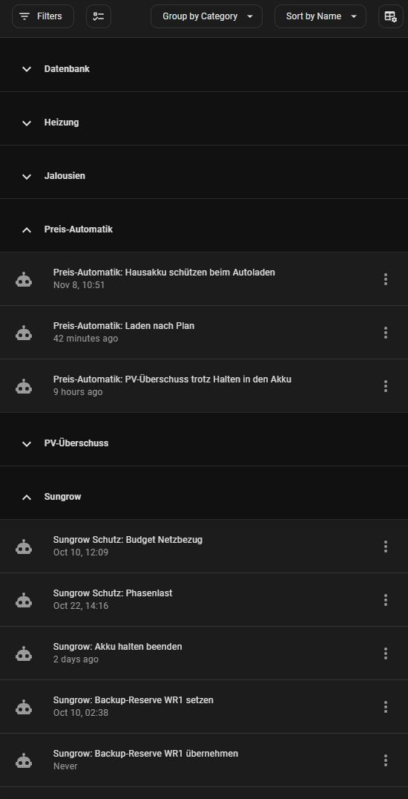

# Home Assistant: Vorlagen aus meiner Installation

Ausschnitte aus einer echten Home-Assistant-Installation (Core 2026.10) zum Abschauen und Anpassen.
Nichts davon läuft ohne Anpassung: Entity-IDs, Geräte und Grenzwerte sind die meiner Anlage.

## Inhalt

| Ordner | Worum es geht |
|---|---|
| [sungrow-modbus/](sungrow-modbus/) | Modbus-Sensoren für **zwei** Sungrow SH-RT (WR1 mit Netzzähler, WR2 ohne). Abgewandelt von [mkaiser/Sungrow-SHx-Inverter-Modbus-Home-Assistant](https://github.com/mkaiser/Sungrow-SHx-Inverter-Modbus-Home-Assistant) (Stand 2023-12-31). **Dort gibt es neuere Versionen**, für eine Neuinstallation besser mit dem aktuellen Original anfangen. |
| [zwei-wechselrichter/](zwei-wechselrichter/) | Summen, Mittelwerte und Energiefluss für zwei Wechselrichter (Akkus saldiert), Karte für die tesla-style-solar-power-card. |
| [sungrow-steuerung/](sungrow-steuerung/) | Hausakkus per Modbus schalten (Normalbetrieb, Akku halten, Zwangsladen aus dem Netz) mit Leistungsregelung unter Netzbudget und Phasengrenze, Notbremsen, Neustart-Schutz, Backup-Reserve. Dazu die Automationen der Preis-Automatik (Tibber). |
| [ladeplan/](ladeplan/) | Der Plan dahinter: je Viertelstunde laden, halten oder freigeben nach Tibber-Preisen, PV-Prognose und Verbrauch. Dazu Tibber-Preisvorschau, Akku-Schutz beim Autoladen und die Karte „Strompreis effektiv". |
| [pv-ueberschuss/](pv-ueberschuss/) | Steckdose bei PV-Überschuss zuschalten, mit Hysterese gegen Flattern. |
| [heizung/](heizung/) | Heizkörperthermostate folgen einem Raumthermostat (Homematic / Homematic IP), Fenster offen → aus, manuelles Verstellen gilt 2 Stunden (Lüften zählt nicht mit). |
| [jalousien/](jalousien/) | Jalousien nach Sonnenstand (Shelly 2PM Gen3), mit Wiederholung bei Verbindungsabbrüchen. |
| [recorder/](recorder/) | Datenbank klein halten: Aufräumen ohne Repack, laute Sensoren nur wenige Tage behalten. |
| [ha-config-git/](ha-config-git/) | Die Konfiguration über ha-mcp in ein Git-Repo spiegeln, z. B. aus einer Claude-Code-Session heraus. |

Jede Datei beschreibt im Kopf, was drin ist, was sie braucht und wie man sie einbindet. Die größeren Ordner haben
zusätzlich eine kurze README.

## Aufbau je Ordner

- `automations_*.yaml`: Automationen (Liste wie in `automations.yaml`)
- `scripts_*.yaml`: Skripte, die die Automationen aufrufen
- `helfer_*.yaml`: Helfer (`input_boolean`, `input_number`, `timer`) und Template-Sensoren als Package

Am einfachsten: Automationen und Skripte in der UI neu anlegen, „In YAML bearbeiten" und den Block
einfügen. Dann bleiben sie in der UI editierbar. Helfer als Package einbinden
(`homeassistant: packages: !include_dir_named packages`) oder in der UI mit denselben Namen anlegen.

## Ordnung in Home Assistant: Kategorien statt vieler Dateien

Hier sind die Automationen nach Themen auf Dateien verteilt. In der eigenen Installation lasse ich sie in der einen
`automations.yaml`: Nur die kann der UI-Editor bearbeiten. Ordnung schaffen dort **Kategorien**
(Einstellungen → Automationen, „Gruppieren nach Kategorie").

## Lizenz

[MIT](../LICENSE), ohne Gewähr. Die Dateien in `sungrow-modbus/` stammen ursprünglich von Martin Kaiser
und stehen unter seiner MIT-Lizenz ([LICENSE-mkaiser](sungrow-modbus/LICENSE-mkaiser)).
