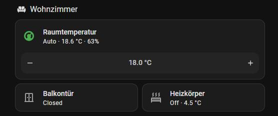

# Heizung: Heizkörper folgen dem Raumthermostat

Je Raum ein Wandthermostat (misst und gibt den Sollwert vor, mit Wochenprogramm) und ein Heizkörperthermostat
(Homematic / Homematic IP, auch Shelly BLU TRV). Home Assistant öffnet den Heizkörper, wenn der Raum zu kalt
ist, und schließt ihn, sobald er warm genug ist oder ein Fenster aufgeht.

## Wie es regelt

- Heizkörper auf (Soll + 3 °C, höchstens 26 °C), sobald der Raum 0,3 °C unter Soll liegt; zu, sobald er 0,1 °C
  darüber liegt. Dazwischen bleibt der letzte Zustand (Hysterese). Gesendet wird nur, wenn sich etwas ändern muss.
- Fenster oder Tür offen → Heizkörper aus. Ein Raum kann mehrere Kontakte haben, zum Beispiel die Küche ohne
  eigene Heizung, die zum Wohnzimmer offen ist. Ein Raum ohne Fensterkontakt geht auch: Die Automation übergibt
  dann eine leere Liste (`fenster: []`), siehe „Heizung: Kinderzimmer".
- Manuelles Verstellen am Wandthermostat gilt **2 Stunden**, danach zurück aufs Wochenprogramm. Solange ein Fenster
  offen ist, ruht dieser Timer. Sonst verbraucht das Lüften die 2 Stunden.
- **Thermostate ohne „Aus":** Neuere HmIP-Thermostate gehen bei „Aus" auf 5 °C. Der Shelly BLU TRV kennt nur
  „Heizen" und wird zum Schließen auf seine Mindesttemperatur gestellt (4 °C). Beides zählt als zu.
- **Gemischte Geräte und mehrere Heizkörper:** Homematic, Homematic IP und Shelly BLU TRV (über ein Shelly BLU
  Gateway Gen3) funktionieren nebeneinander. Hat ein Raum mehrere Heizkörper, ruft seine Automation das Skript
  je Heizkörper einmal auf, siehe „Heizung: Büro 1". Der 2-Stunden-Timer hängt nur am ersten Aufruf.
- Zwei Absicherungen gegen per Funk verlorene Befehle, je höchstens alle 15 Minuten:
  - **Aus wiederholen:** Der Heizkörper zeigt „Aus", der Raum liegt aber mindestens 1 °C über Soll und der Fühler
    am Heizkörper mindestens 0,8 °C über dem Raum. Sonst heizt er unbemerkt weiter.
  - **Ein wiederholen:** Der Heizkörper zeigt „Heizen", der Raum liegt aber mindestens 1 °C unter Soll und der
    Fühler am Heizkörper höchstens 0,3 °C über dem Raum. Nur bei unter 15 °C Außentemperatur, weil die Heizung
    sonst ohnehin nicht läuft.

  „Aus wiederholen" greift auch über den Trend-Helfer, siehe „Raum wird trotz Aus wärmer".

  Die Außentemperatur kommt aus `weather.forecast_home_assistant`: durch die eigene Wetter-Entität ersetzen,
  die 15 °C sind ein Vorschlag. Die Raum-Automationen laufen dafür alle 5 Minuten.
- **Raum wird trotz Aus wärmer:** Ein Trend-Helfer je Raum meldet, wenn die Raumtemperatur um mehr als 0,3 °C
  je Stunde steigt. Steht der Heizkörper dabei auf „Aus", liegt der Raum mindestens 1 °C über Soll, hat es
  draußen unter 15 °C und liegt der Fühler am Heizkörper mindestens 0,3 °C über dem Raum, wird ebenfalls „Aus"
  wiederholt. Hält das 30 Minuten an, kommt eine Meldung aufs Handy: Bei einem Ventil, das mechanisch nicht
  schließt, hilft Wiederholen nicht. Bei mehreren Heizkörpern im Raum zählt der wärmste.

  Die 0,3 °C am Heizkörper verhindern Fehlmeldungen, wenn der Raum durch Geräte, eine Klimaanlage oder eine
  offene Tür zum Nachbarraum wärmer wird und der Heizkörper kalt ist. Einschränkung: Ein Ventil, das nur leicht
  durchlässt und den Fühler kaum erwärmt, wird so nicht gemeldet.
- **Raumthermostat misst falsch (Zugluft, Klimaanlage):** Das optionale Skriptfeld `ist_sensor` ersetzt die
  Ist-Temperatur des Raumthermostats durch einen eigenen Sensor, zum Beispiel den Mittelwert aus zwei Fühlern
  (`sensor.raumtemperatur_buro_1` in „Heizung: Büro 1"). Fällt der Sensor aus, gilt wieder das Raumthermostat.
  Der Sollwert kommt immer vom Raumthermostat.

## Raum ohne Raumthermostat

Für Räume, in denen nur ein Heizkörperthermostat und ein Fensterkontakt hängen, zum Beispiel ein Bad: Der
Heizkörper regelt selbst nach seinem Sollwert, „Heizung: Bad OG" kümmert sich nur ums Fenster. Die Automation
braucht weder das Skript noch einen Helfer.

- Fenster geht auf → Heizkörper auf die Mindesttemperatur (Shelly BLU TRV: 4 °C), also zu.
- Nach dem Schließen des Fensters bleibt er zu, bis jemand von Hand wieder aufdreht. Der alte Sollwert wird
  bewusst nicht zurückgestellt.
- Dreht jemand bei offenem Fenster wieder auf, schließt die Automation sofort erneut. Zusätzlich prüft sie
  alle 5 Minuten, falls ein Befehl nicht ankam.

## Shelly BLU TRV: Empfang

Die Thermostate hängen per Bluetooth am Shelly BLU Gateway. Durch eine Geschossdecke lag der Empfang z. B. bei
−83 bis −87 dBm: Das funktioniert, ist aber grenzwertig. Ein Gateway je Etage ist sicherer. Nach einem
Firmware-Update des Gateways kann es nötig sein, die Shelly-Integration in Home Assistant einmal neu zu laden.

## Dateien

| Datei | Inhalt |
|---|---|
| `automations_heizung.yaml` | je Raum eine Automation, dazu „Soll nach 2 h zurück aufs Programm", die Meldung „Raum wird trotz Aus wärmer" und „Bad OG" für einen Raum ohne Raumthermostat |
| `scripts_heizung.yaml` | `heizung_raum_regeln`: die Regelung eines Raums (Thermostat, Heizkörper, Fenster, Timer, Trend-Helfer, eigener Temperatursensor) |
| `helfer_heizung.yaml` | die 2-Stunden-Timer, die Trend-Helfer „Raumtemperatur steigt" und der Mittelwert-Sensor „Raumtemperatur Büro 1" |

Neuer Raum: eine Automation kopieren, Thermostate und Fenster eintragen, Timer und Trend-Helfer anlegen und in
„Soll nach 2 h zurück" sowie in „Raum wird trotz Aus wärmer" (Trigger und `raeume`) ergänzen.

Für die Meldung `notify.mobile_app_DEIN_HANDY` durch den Meldedienst des eigenen Handys ersetzen.
