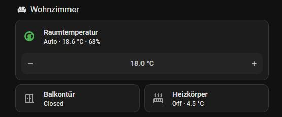

# Heizung: Heizkörper folgen dem Raumthermostat

Je Raum ein Wandthermostat (misst und gibt den Sollwert vor, mit Wochenprogramm) und ein Heizkörperthermostat
(Homematic / Homematic IP). Home Assistant öffnet den Heizkörper, wenn der Raum zu kalt ist, und schließt ihn,
sobald er warm genug ist oder ein Fenster aufgeht.

## Wie es regelt

- Heizkörper auf (Soll + 3 °C, höchstens 26 °C), sobald der Raum 0,3 °C unter Soll liegt; zu, sobald er 0,1 °C
  darüber liegt. Dazwischen bleibt der letzte Zustand (Hysterese). Gesendet wird nur, wenn sich etwas ändern muss.
- Fenster oder Tür offen → Heizkörper aus. Ein Raum kann mehrere Kontakte haben, zum Beispiel die Küche ohne
  eigene Heizung, die zum Wohnzimmer offen ist.
- Manuelles Verstellen am Wandthermostat gilt **2 Stunden**, danach zurück aufs Wochenprogramm. Solange ein Fenster
  offen ist, ruht dieser Timer. Sonst verbraucht das Lüften die 2 Stunden.
- Neuere HmIP-Thermostate kennen kein „Aus" und gehen auf 5 °C. Das zählt ebenfalls als zu.

## Dateien

| Datei | Inhalt |
|---|---|
| `automations_heizung.yaml` | je Raum eine Automation, dazu „Soll nach 2 h zurück aufs Programm" |
| `scripts_heizung.yaml` | `heizung_raum_regeln`: die Regelung eines Raums (Thermostat, Heizkörper, Fenster, Timer) |
| `helfer_heizung.yaml` | die 2-Stunden-Timer |

Neuer Raum: eine Automation kopieren, Thermostate und Fenster eintragen, Timer anlegen und in
„Soll nach 2 h zurück" ergänzen.
