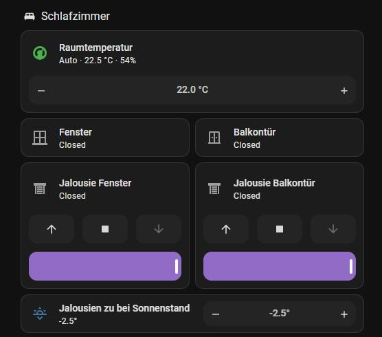

# Jalousien nach Sonnenstand

Jalousien mit Shelly 2PM Gen3 fahren abends zu, sobald die Sonne einen einstellbaren Winkel unter dem Horizont
erreicht. Das passt sich übers Jahr von selbst an, anders als eine feste Uhrzeit.

*Zwei Jalousien im Schlafzimmer und der Regler „Jalousien zu bei Sonnenstand" (Grad unter dem Horizont).*

## Was dabei hilft

- **Balkontür offen:** Deren Jalousie wartet, bis die Tür zu ist (höchstens 3 Stunden), damit niemand ausgesperrt wird.
- **WLAN-Aussetzer:** Die Shellys verlieren ab und zu kurz die Verbindung, ein Befehl genau dann scheitert.
  `jalousie_sicher_fahren` wiederholt ihn bis zu 6-mal im Abstand von 8 s, bis sich die Jalousie bewegt.
- **Büro:** morgens 30 Minuten nach Sonnenaufgang wieder hoch.

## Dateien

| Datei | Inhalt |
|---|---|
| `automations_jalousien.yaml` | Büro (runter und hoch) und Schlafzimmer (abends zu) |
| `scripts_jalousien.yaml` | `jalousie_sicher_fahren` und `jalousie_befehl` |
| `helfer_jalousien.yaml` | Sonnenstand-Regler je Raum |

Die Automationen nutzen den Trigger `sun.elevation_crossed_threshold` (neuere HA-Versionen), dessen Schwelle
direkt auf einen Zahlen-Helfer zeigen kann.
