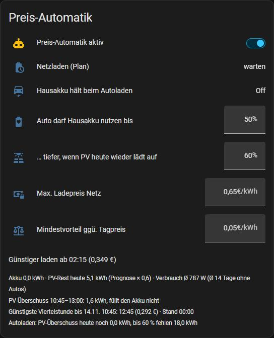
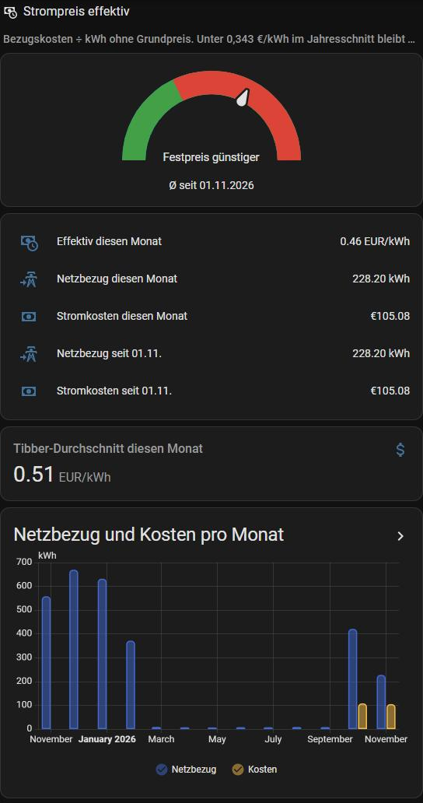

# Ladeplan: Hausakkus nach dynamischem Strompreis und PV-Prognose

Ein rollierender Plan für jede Viertelstunde: **laden** (aus dem Netz, wenn es später teurer wird),
**halten** (Akku-Energie für die teuren Stunden aufheben) oder **freigeben**. Er rechnet alle 15 Minuten neu
mit Tibber-Preisen (heute + morgen), der PV-Prognose von Forecast.Solar und dem Hausverbrauch.
Umgesetzt wird er von den Automationen in [../sungrow-steuerung/automations_preis_automatik.yaml](../sungrow-steuerung/automations_preis_automatik.yaml).

*Die Karte im Dashboard: Einstellungen oben, darunter die Entscheidung des Plans mit Begründung
(Akku-Energie, PV-Rest, Verbrauch, PV-Überschussfenster, günstigste Viertelstunde).*

## Was der Plan berücksichtigt

- Der Akku bedient die **teuersten** Viertelstunden bis zum nächsten PV-Überschuss, nicht einfach die nächsten.
- Laden nur, wenn der Preis jetzt / 0,9 (Verluste) + Mindestvorteil unter den teuren Viertelstunden liegt.
- Halten, wenn die Energie später ≥ 2 ct mehr spart, aber nicht, wenn vorher noch günstig nachgeladen werden kann.
- PV-Prognose mit Korrekturfaktor (echter Ertrag / Prognose der letzten 14 Tage). Für morgen gilt ein **vorsichtiger**
  Faktor (Mittel der schlechteren Hälfte), weil fehlende PV am Abend teuer wird. Heute wird nach der echten PV gedeckelt.
- Deckel auf den besten echten Tag der Vorjahre (`pv_historie.jinja`), denn die Prognose kennt keinen Schatten.
- Akku-Schutz: Lädt ein Auto und ist der Hausakku knapp, wird er gehalten statt ins Auto entladen.

## Dateien

| Datei | Wohin | Inhalt |
|---|---|---|
| `netzladeplan.jinja` | `config/custom_templates/` | Der Plan (Makro `ladeplan()`), ausführlich kommentiert |
| `pv_historie.jinja` | `config/custom_templates/` | Mittel und Maximum des echten PV-Ertrags je Kalendertag. Hier **leer**, dann entfällt der Deckel; mit `pv_historie.py` aus den eigenen Daten füllen |
| `pv_historie.py` | `tools/` deines Config-Repos | Erzeugt `pv_historie.jinja` aus der Langzeitstatistik; braucht [../ha-config-git/sync_from_ha.py](../ha-config-git/) |
| `energie_automatik.yaml` | Package | `sensor.netzladeplan`, PV-Prognose-Faktor, Autoladeleistung, Akku-Schutz |
| `tibber.yaml` | Package | `sensor.tibber_preise` mit den Viertelstundenpreisen (Aktion `tibber.get_prices`) |
| `helfer_ladeplan.yaml` | Package | Grenzwerte, Saison und die Statistik-Sensoren (bei mir UI-Helfer) |
| `helfer_strompreis_effektiv.yaml` + `karte_strompreis_effektiv.yaml` | Package + Dashboard | Effektiver Bezugspreis je Monat und Jahr, Tacho mit Festpreis-Schwelle |
| `karte_preis_automatik.yaml` | Dashboard | Die Karte „Preis-Automatik" aus dem ersten Bild (Einstellungen und Begründung des Plans) |

## Voraussetzungen und Anpassen

- Tibber-Integration und Forecast.Solar; zwei Sungrow-Akkus mit den Sensoren aus [../sungrow-modbus/](../sungrow-modbus/)
  und den Summen aus [../zwei-wechselrichter/](../zwei-wechselrichter/). Mit einem Wechselrichter die WR2-Teile entfernen.
- **Autos:** `sensor.autoladeleistung` kennt meine Wallbox und zwei Autos über deren Integration
  (Platzhalter `auto_1`, `auto_2`). Eigene Wallbox bzw. Fahrzeuge eintragen; ohne Auto einfach `0`.
- Akkugröße kommt aus den Modbus-Sensoren (Kapazität, Min-/Max-SoC, Backup-Reserve), Wirkungsgrad `eta = 0.9` im Makro.
- Das PV-Fenster (Sonnenaufgang + 2 h bis Sonnenuntergang − 2,5 h) ist auf meine Verschattung eingestellt.
- Testen: Das Makro nimmt Testwerte für SoC, PV-Rest, Verbrauch, Uhrzeit und PV-Leistung an, z. B. in den
  Entwicklerwerkzeugen: `{{ ladeplan(30, 5, none, '2026-11-11T04:00:00+01:00', 0) }}`.

## Lohnt sich das? Karte „Strompreis effektiv"

Ob sich das Ganze lohnt, hängt am Preisniveau. Die Karte rechnet Bezugskosten ÷ kWh je Monat und seit Beginn des
„Stromjahrs" und vergleicht mit der Schwelle, ab der ein Festpreis-Tarif günstiger wäre (eigener Wert, im Bild 0,343 €/kWh).
Darunter der Tibber-Durchschnitt des Monats: Der Abstand zeigt, was die Lastverschiebung bringt.

Helfer dazu: `helfer_strompreis_effektiv.yaml`, Karte: `karte_strompreis_effektiv.yaml`.
