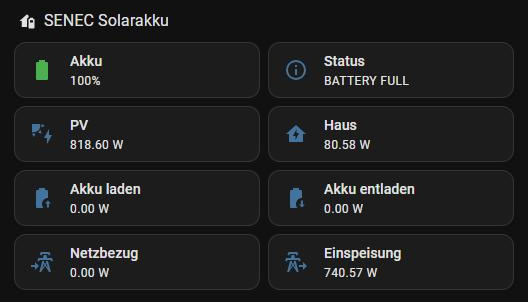
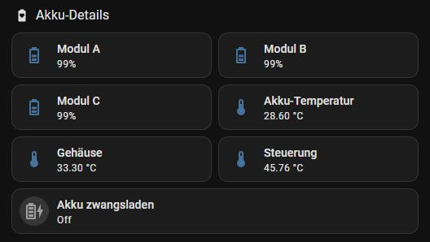
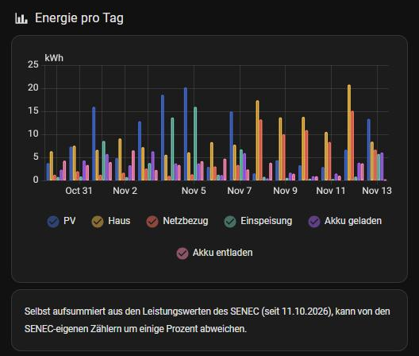

# SENEC-Solarakku: Live-Werte, Akku-Module und Energie pro Tag

Eine Dashboard-Ansicht für einen SENEC.Home-Speicher über die Integration
[marq24/ha-senec-v3](https://github.com/marq24/ha-senec-v3) (HACS). Die Integration liefert vor allem Leistungen und
Zustände. Die **Tagesenergie** (PV, Haus, Netzbezug, Einspeisung, Akku geladen/entladen) wird hier aus den
Leistungswerten selbst aufsummiert, mit Integral-Helfern (Riemann-Summe). Damit gibt es Langzeitstatistik und
Tagesbalken, unabhängig davon, welche Zähler das SENEC-Gerät selbst herausgibt.

*Abschnitt „SENEC Solarakku": Der Akku ist voll, die PV versorgt das Haus und speist den Rest ein.*

## Was die Ansicht zeigt

- **SENEC Solarakku:** Ladestand, Systemstatus, PV, Haus, Akku laden/entladen, Netzbezug, Einspeisung (live)
- **Akku-Details:** Ladestand je Modul (A/B/C), Temperaturen von Akku, Gehäuse und Steuerung, Schalter
  „Akku zwangsladen" (Safe Charge der Integration)
- **Energie pro Tag:** Balken der letzten 14 Tage aus den selbst aufsummierten Zählern

Die Modul-Ladestände zeigen, ob die Module auseinanderlaufen. Ein Modul, das dauerhaft tiefer liegt, ist ein früher
Hinweis auf Alterung.

*Abschnitt „Akku-Details": Ladestand je Modul, Temperaturen und der Schalter für Safe Charge.*

*Abschnitt „Energie pro Tag": Tagesbalken aus den selbst aufsummierten Zählern.*

## Dateien

| Datei | Wohin | Inhalt |
|---|---|---|
| `helfer_senec.yaml` | Package (oder UI-Helfer „Integral") | sechs Energiezähler aus den SENEC-Leistungen |
| `ansicht_senec.yaml` | Dashboard, Raw-Konfigurationseditor | die Ansicht mit drei Abschnitten |

## Hinweise

- Die Zähler beginnen beim Anlegen bei 0. Für die Tagesbalken braucht es ein paar Tage Daten.
- Selbst aufsummiert heißt: wenige Prozent Abweichung zu den SENEC-eigenen Zählern sind normal, vor allem wenn
  die Integration selten abfragt. `max_sub_interval` sorgt dafür, dass auch lange konstante Werte (nachts 0 W)
  sauber weiterzählen.
- Entity-IDs mit Präfix `sensor.senec_` sind die Standardnamen der Integration. Bei mehreren Geräten oder
  umbenannten Entitäten anpassen.
