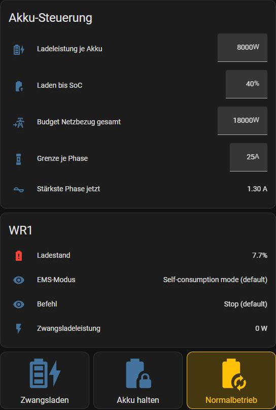

# Sungrow: Hausakkus steuern und absichern

Zwei Sungrow SH-RT mit Akku, per Modbus geschaltet: **Normalbetrieb**, **Akku halten** (weder laden noch entladen)
oder **Zwangsladen aus dem Netz**. Das Skript `sungrow_akku_modus` schaltet einen Wechselrichter, die Automationen
passen die Ladeleistung laufend an und fangen Fehler ab.

*Grenzwerte für das Zwangsladen, Zustand je Wechselrichter und Tasten für die drei Modi. Die aktive Taste ist
hervorgehoben (card_mod).*

## Was die Automationen absichern

- **Netzbudget und Phasengrenze:** Die Ladeleistung wird alle 30 s so verteilt, dass Netzbezug und stärkste Phase
  unter den eingestellten Grenzen bleiben, inklusive Haus und Auto. Reicht das nicht, greifen zwei Notbremsen.
- **Ziel-SoC:** Jeder Wechselrichter hört am Ziel auf und geht ins Halten oder in den Normalbetrieb zurück.
- **Neustart:** Nach einem Neustart von Home Assistant läuft kein Zwangsladen unbeaufsichtigt weiter.
- **Backup-Reserve:** Regler in HA und Register im Wechselrichter bleiben in beide Richtungen synchron.
- **Preis-Automatik:** setzt den [Ladeplan](../ladeplan/) um und lässt echten PV-Überschuss trotz Halten in den Akku.

## Dateien

| Datei | Inhalt |
|---|---|
| `automations_sungrow.yaml` | 8 Automationen: Nachregeln, Notbremsen, Ziel-SoC, Neustart, Halten beenden, Backup-Reserve |
| `automations_preis_automatik.yaml` | 3 Automationen der Preis-Automatik (braucht [../ladeplan/](../ladeplan/)) |
| `scripts_sungrow.yaml` | `sungrow_akku_modus`: Modus eines Wechselrichters schalten, mit Prüfung der Übernahme |
| `helfer_sungrow.yaml` | Helfer und die Template-Sensoren „WR1/WR2 Akku-Modus" und „Netz max Phasenstrom" |
| `karte_akku_steuerung.yaml` | die Dashboard-Karte aus dem Bild |

Voraussetzung sind die Modbus-Sensoren aus [../sungrow-modbus/](../sungrow-modbus/). Was jede Datei sonst braucht,
steht in ihrem Kopf.
