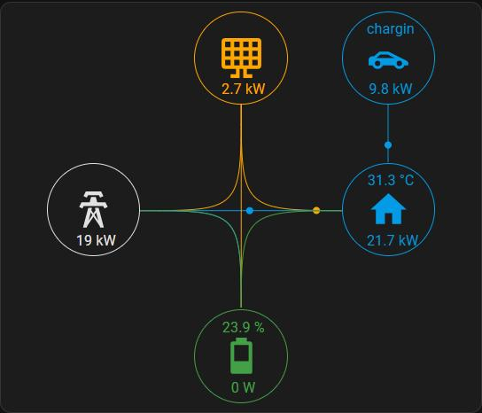

# Zwei Sungrow-Wechselrichter: Summen und Energiefluss

Für zwei Sungrow SH-RT mit Akku an einem Hausanschluss: WR1 hat den Netzzähler, WR2 nicht.
Die Modbus-Sensoren liefern alles je Wechselrichter; diese Templates machen daraus Werte für die ganze Anlage.

*Energiefluss-Karte beim Autoladen: 19 kW aus dem Netz und 2,7 kW von der PV fließen ins Haus, davon 9,8 kW über
die Wallbox ins Auto. Der Akku steht. Bei PV-Überschuss fließt es entsprechend in den Akku und ins Netz.*

## Dateien

| Datei | Wohin | Inhalt |
|---|---|---|
| `templates_solarsystem_summary.yaml` | Package | Summen (PV, Akku laden/entladen, Hausverbrauch, Tages-/Monats-/Jahreswerte), Mittelwerte (SoC, Temperatur), Hausverbrauch ohne Wallbox |
| `templates_energiefluss.yaml` | Package | Flüsse Netz → Haus/Akku, Akku → Haus/Netz, PV → Netz/Haus/Akku, Wechselrichter-Verluste |
| `power_flow.jinja` | `config/custom_templates/` | Die Rechnung dazu (ein Makro, alle Flüsse aus denselben Werten) |
| `templates_wallbox.yaml` | Package | Ladeleistung der Wallbox aus Strom × Spannung je Phase |
| `karte_energiefluss.yaml` | Dashboard | Karte für die [tesla-style-solar-power-card](https://github.com/reptilex/tesla-style-solar-power-card) (HACS) |

## Was die Energiefluss-Rechnung beachtet

- Die Akkus werden saldiert: Lädt einer, während der andere entlädt, ist das ein interner Ausgleich, kein Fluss.
- PV-Flüsse sind auf die verfügbare PV gedeckelt. Die Register werden nicht gleichzeitig gelesen (10/20/60 s
  Intervall) und würden sonst bei Lastsprüngen überschießen.
- Hausverbrauch = Last von WR1 + AC-Leistung von WR2.

## Voraussetzungen

Modbus-Sensoren aus [../sungrow-modbus/](../sungrow-modbus/) (Präfixe „WR1"/„WR2"). Die `sensor.wallbox_*` sind Platzhalter
für die Entities der eigenen Wallbox. Ohne Wallbox `templates_wallbox.yaml` weglassen und in den Summen
`sensor.wallbox_load_power` durch `0` ersetzen.
